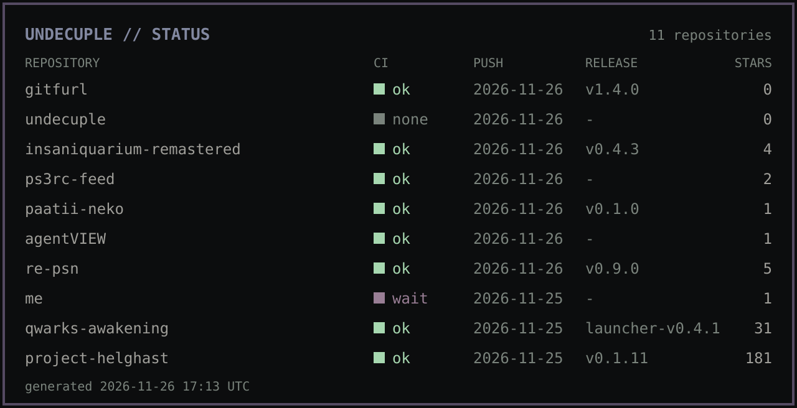

  
  
  

<h3 align="center">Ports</h3>

<table align="center">
<tr><td align="center" valign="top" width="340"> <b><a href="https://github.com/undecuple/project-helghast">Killzone 3</a></b> PC port of a PS3 shooter by static recompilation. Needs your own copy of the game. Work in progress.</td><td align="center" valign="top" width="340"> <b><a href="https://github.com/undecuple/project-pyrrhus">Killzone 2</a></b> PC port of a PS3 shooter by static recompilation. Needs your own copy of the game. Work in progress.</td></tr>
<tr><td align="center" valign="top" width="340"> <b><a href="https://github.com/undecuple/qwarks-awakening">Qwark's Awakening</a></b> PC port of 10 Ratchet &amp; Clank games for the PS3 by static recompilation. Early work, not playable yet.</td><td align="center" valign="top" width="340"> <b><a href="https://github.com/undecuple/paatii-neko">Paatii Neko</a></b> PC port of a PS3 party game by static recompilation. Needs your own copy of the game.</td></tr>
</table>

<h3 align="center">Tools</h3>

<table align="center">
<tr><td align="center" valign="top" width="340"> <b><a href="https://github.com/undecuple/re-psn">re:psn</a></b> A reimplementation of PSN services (rooms, matchmaking, leaderboards) for recompiled PS3 games.</td><td align="center" valign="top" width="340"> <b><a href="https://github.com/undecuple/ps3rc-feed">ps3rc feed</a></b> Activity feed for PS3 recompilation projects on GitHub. Read-only, not real time.</td></tr>
<tr><td align="center" valign="top" width="340"> <b><a href="https://github.com/undecuple/gitfurl">gitfurl</a></b> Helper for running your own Windows installers on Linux, with a graphical app.</td><td align="center" valign="top" width="340"><a href="https://github.com/undecuple/agentVIEW"><picture><source media="(prefers-color-scheme: light)" srcset="https://raw.githubusercontent.com/undecuple/agentVIEW/main/assets/banner-light.svg"></picture></a> <b><a href="https://github.com/undecuple/agentVIEW">agentVIEW</a></b> Local-first Linux control desk for coding-agent sessions: terminals, hierarchy views and records.</td></tr>
<tr><td align="center" valign="top" colspan="2"> <b><a href="https://github.com/undecuple/insaniquarium-remastered">Insaniquarium Remastered</a></b> Mods for Insaniquarium! Deluxe: online co-op, extra modes, achievements and more.</td></tr>
</table>

<h3 align="center">Related projects</h3>

<table align="center">
<tr><td align="center" valign="top" width="340"> <b><a href="https://github.com/undecuple/jsp-vs-ex">J-Stars Victory VS-EX</a></b> Fan revival of a PS3 fighter as a PC port. Work in progress.</td><td align="center" valign="top" width="340"> <b><a href="https://github.com/undecuple/project-vekta">Killzone HD</a></b> PC port of a PS3 shooter by static recompilation. Work in progress.</td></tr>
</table>
