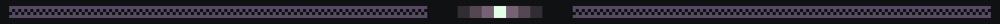

  

<b>Unofficial fan work.</b> Native PC ports and recompilation tooling for PlayStation 3 games, plus the servers and helpers around them. No game files are distributed.

  
  
  

<!-- status:start -->
| repository | ci | last push | release | stars |
|---|---|---|---|---|
| [ps3rc-feed](https://github.com/undecuple/ps3rc-feed) | fail | 2026-11-26 | - | 2 |
| [me](https://github.com/undecuple/me) | wait | 2026-11-25 | - | 1 |
| [qwarks-awakening](https://github.com/undecuple/qwarks-awakening) | ok | 2026-11-25 | launcher-v0.4.1 | 31 |
| [project-helghast](https://github.com/undecuple/project-helghast) | ok | 2026-11-25 | v0.1.11 | 177 |
| [project-pyrrhus](https://github.com/undecuple/project-pyrrhus) | ok | 2026-11-25 | v0.1.13 | 169 |
| [re-psn](https://github.com/undecuple/re-psn) | ok | 2026-11-25 | v0.9.0 | 5 |
| [gitfurl](https://github.com/undecuple/gitfurl) | ok | 2026-11-25 | v1.3.0 | 0 |
| [agentVIEW](https://github.com/undecuple/agentVIEW) | ok | 2026-11-25 | - | 1 |
| [paatii-neko](https://github.com/undecuple/paatii-neko) | ok | 2026-11-24 | v0.1.0 | 1 |
| [insaniquarium-remastered](https://github.com/undecuple/insaniquarium-remastered) | ok | 2026-11-18 | v0.4.3 | 4 |
<!-- status:end -->

Generated 2026-11-26 05:09 UTC by a scheduled workflow from the [status site](https://undecuple.github.io/me/). The card is an image that GitHub caches, so it can lag by minutes to hours. Prepared with AI agent assistance under the maintainer's direction.
